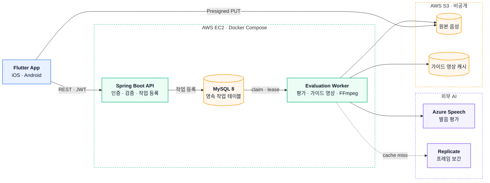
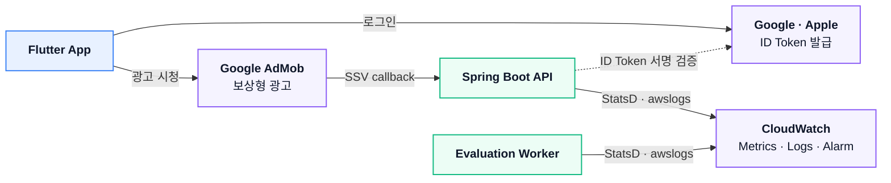
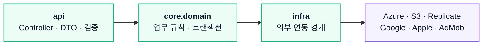
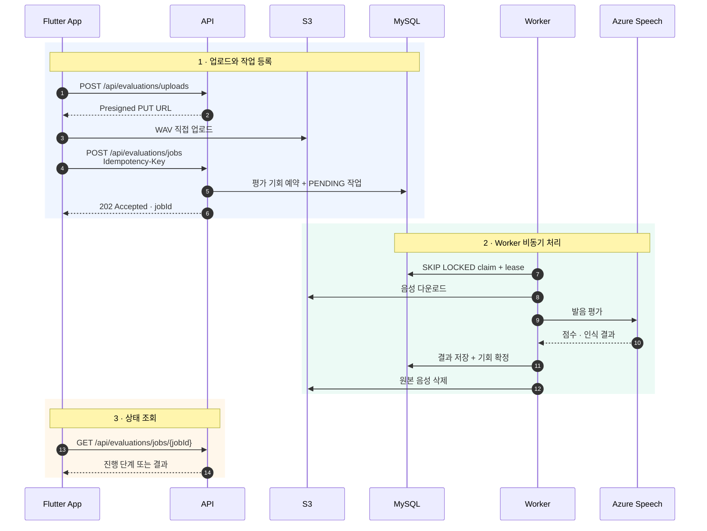
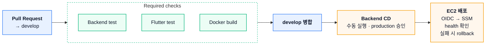

# LingKo

한국어 문장을 **듣고, 말하고, 피드백을 확인하는** 모바일 발음 학습 개인 프로젝트입니다. Flutter 앱과 Spring Boot 백엔드를 직접 설계·구현했고, AWS EC2 한 대의 Docker Compose 환경에 배포해 운영합니다. 인증, 비동기 작업, 외부 AI 연동, 데이터 정합성, 운영 관측성을 다룹니다.

> 한국어는 철자와 실제 발음이 다릅니다(연음, 비음화, 경음화 등). LingKo는 원문을 음운 규칙이 적용된 **표준 발음**으로 보여주고, 사용자의 녹음을 **AI 발음 평가**로 채점하고, 음절마다 **입·혀 위치 가이드**를 보여줘 다시 연습하게 합니다.

## 목차

- [주요 기능](#주요-기능)
- [시스템 설계](#시스템-설계)
- [핵심 흐름](#핵심-흐름)
- [기술적 설계 포인트](#기술적-설계-포인트)
- [품질과 배포](#품질과-배포)
- [기술 스택](#기술-스택)
- [저장소 구조](#저장소-구조)
- [시작하기](#시작하기)
- [문서](#문서)

## 주요 기능

| 기능 | 설명 |
|---|---|
| 문장 연습 | 6개 주제(음식·일상·여행·학습·업무·건강)별 8개, 총 48개 추천 문장과 자유 입력 문장. 표준 발음·로마자 가이드, TTS, 녹음 |
| 표준 발음 변환 | 대표 받침, 연음, 겹받침, 비음화, 유음화, 경음화, 구개음화, `ㅎ` 규칙, 자음 뒤 `ㅢ`를 처리합니다. 형태소 분석기·예외 사전은 포함하지 않습니다 |
| 발음 평가 | 음성을 비공개 S3에 직접 업로드하고, 독립 Worker가 Azure Speech 평가를 처리합니다. 앱은 작업 상태를 조회해 문장·단어 점수를 표시합니다 |
| 시각적 가이드 | 한글 음절을 초성·중성·종성 역할로 분해하고 입·혀 이미지를 시간순 전이 영상으로 조합합니다. 주요 조음 위치를 보여주는 학습 참고 자료이며 실제 발성 기관 움직임을 정밀 시뮬레이션하지 않습니다 |
| 학습 기록 | 평가 기록, 약한 발음, 저장 문장, 재연습. 단어 점수와 음절 가이드를 구분하며 없는 음절 점수를 추정해 표시하지 않습니다 |
| 계정과 이용 정책 | Google·Apple 로그인, 기기별 토큰 세션, 버전별 약관 동의와 별도 AI 전송 동의, 최대 5회·1시간마다 1회 충전되는 평가 기회, 서버 검증(SSV) 광고 보상 |

## 시스템 설계

### 전체 구성



로그인, 광고 보상, 모니터링은 핵심 평가 경로와 분리해 따로 그렸습니다.



API는 요청 경로에서 인증·권한·입력 검증과 작업 등록만 하고, 느린 음성 평가와 미디어 처리는 별도 Worker 프로세스가 맡습니다. 두 프로세스는 메시지 큐 없이 MySQL의 영속 작업 테이블로 연결됩니다([ADR-0009](docs/architecture/adr/0009-independent-db-evaluation-worker.md)).

### 계층과 책임



| 경계 | 책임 |
|---|---|
| Flutter (`app/lib`) | 세션 복원, 동의 gate, 녹음, 업로드, 상태 조회, 학습 UI. 화면·서비스·API client를 분리 |
| `api` | 인증·소유권·입력 검증, 업로드 티켓 발급, 작업 등록과 조회. Entity를 응답으로 직접 노출하지 않음 |
| `core.domain` | 평가 기회 예약·확정·복구, 작업 상태 전이, 결과 영속화 |
| Worker | DB 작업 claim, 외부 평가·미디어 처리, 성공·실패 반영 |
| `infra` | 외부 응답 파싱, S3 객체 처리, 미디어 생성·캐시 |
| MySQL / Flyway | 사용자 데이터, 영속 작업, 평가 결과, 스키마 버전 |

## 핵심 흐름

### 발음 평가 (비동기)



- 음성은 16-bit mono PCM WAV, 48kHz 이하, 최대 10MiB만 허용합니다.
- 평가가 끝나면 Worker가 원본 음성 삭제를 시도합니다. 제출되지 않거나 남은 객체의 정리는 애플리케이션이 아니라 S3 Lifecycle 설정(1일)에 의존합니다.
- AI 전송 동의가 없으면 서버가 `403 AI_CONSENT_REQUIRED`로 차단하고, Worker도 외부 호출 직전에 동의를 다시 확인합니다.
- 동의 확인·phase·가이드 캐시까지 포함한 전체 순서는 [평가 흐름](docs/architecture/evaluation-flow.md)에 있습니다.

### 인증

Google·Apple ID Token을 서버가 검증한 뒤 자체 Access/Refresh JWT를 발급합니다. Refresh Token은 해시로 기기 세션에 저장하고, 갱신 시 회전하며 재사용을 감지하면 세션을 끊습니다. 약관 동의는 계정이 만들어지기 전에 받습니다. 상세 순서는 [인증 흐름](docs/architecture/authentication-flow.md)을 참고합니다.

## 기술적 설계 포인트

| 문제 | 적용한 설계 |
|---|---|
| 네트워크 재시도로 중복 평가·차감 발생 | 사용자별 Idempotency 키와 작업 생성 트랜잭션 |
| 외부 평가가 API 응답을 오래 점유 | S3 직접 업로드와 영속 DB 작업, 독립 Worker |
| 동시 요청의 평가 기회 경쟁 | 조건부 UPDATE와 짧은 행 잠금, 예약·확정·복구 분리 ([ADR-0006](docs/architecture/adr/0006-atomic-practice-quota-transitions.md)) |
| lease를 잃은 이전 시도가 결과를 덮어씀 | 시도 번호 fencing |
| 만료된 토큰의 동시 갱신 | 서버 토큰 회전·재사용 감지와 앱의 단일 갱신 요청 |
| 반복되는 가이드 영상 생성 비용 | 매핑 버전을 검증하는 DB 미디어 조회와 결정적 S3 캐시 키, 실패 시 정적 이미지 fallback |
| 음성 평가 응답과 한글 단위 불일치 | 단어 정렬 검증, 실제 점수와 음절 가이드 분리 |

현재 기본 구성은 Worker 한 개이며 다중 Worker 처리량이나 장애 복구 성능은 측정하지 않았습니다. DB 상태 전이와 외부 호출은 서로 다른 경계이므로 외부 평가 호출의 exactly-once를 보장하지 않습니다. 구체적인 선택과 제약은 [아키텍처](docs/architecture/system-architecture.md), [ADR](docs/architecture/adr/README.md), [문제 해결 사례](docs/engineering/case-studies.md)에 있습니다.

## 품질과 배포



- 테스트는 `test`(단위) / `integrationTest`(외부 미호출 통합) / `externalIntegrationTest`(실제 외부 서비스, 수동 실행)로 나눠 CI가 비밀값 없이 반복 가능하도록 했습니다([ADR-0004](docs/architecture/adr/0004-separate-external-integration-tests.md)).
- `develop`은 PR과 3개 required check 통과가 필요하며, 병합이 곧바로 운영 배포로 이어지지 않습니다.
- GitHub에 장기 AWS Key를 두지 않고 OIDC로 단기 자격 증명을 받습니다.
- 운영 관측성은 CloudWatch Agent, Micrometer → StatsD, Docker awslogs, Alarm → SNS 이메일로 구성합니다([운영 모니터링](docs/operations/monitoring-and-incident-response.md)).

## 기술 스택

| 영역 | 기술 |
|---|---|
| App | Flutter, Dart, Material 3, `record`, `flutter_tts`, `video_player`, `flutter_secure_storage` |
| Backend | Java 21, Spring Boot 3.4, Spring Security, Spring Data JPA, Micrometer |
| Data | MySQL 8, Flyway |
| Integration | Azure Speech, AWS S3, Replicate, FFmpeg(Worker 이미지 내장), Google·Apple 로그인, Google AdMob |
| Infra | AWS EC2, Docker Compose, IAM Instance Profile, SSM, CloudWatch |
| CI/CD | GitHub Actions (Backend CI, Flutter CI, Docker CI, Backend CD, CloudWatch Agent) |
| Test | JUnit, Spring 통합 테스트(별도 sourceSet), Flutter widget·API 테스트, 셸 계약 테스트 |

## 저장소 구조

```text
app/          Flutter 클라이언트
  lib/api/        서버 REST client
  lib/screens/    Home · Practice · Result · Review · Profile · AuthGate
  lib/services/   녹음, TTS, 소셜 로그인, secure storage 세션, 광고
backend/      Spring Boot API와 평가 Worker (같은 이미지)
  src/main/java/com/lingko/lingko/{api,core,infra}
  src/main/resources/db/migration/   Flyway V*.sql
  src/test/ · src/integrationTest/
docs/         제품 · 아키텍처(ADR) · API · 데이터 · 보안 · 운영 · 법무 문서
scripts/      배포 · CloudWatch · S3 권한 스크립트와 계약 테스트
.github/      CI/CD workflow
```

## 시작하기

필요한 것: Java 21, Flutter SDK, Docker. 환경변수는 [`backend/.env.example`](backend/.env.example)을 기준으로 하며 실제 비밀값은 커밋하지 않습니다.

```bash
# 백엔드: API + Worker + MySQL
cd backend
cp .env.example .env   # DB·외부 서비스 값 채우기
docker compose up --build

# 앱
cd app
flutter pub get
flutter run --dart-define=LINGKO_API_BASE_URL=http://localhost:8080
```

Android emulator에서는 호스트 주소로 `10.0.2.2`를 사용합니다. 소셜 로그인·녹음 권한·광고 설정과 테스트 명령은 [로컬 실행](docs/development/local-development.md)과 [테스트 구성](docs/development/testing-and-troubleshooting.md)을 참고합니다.

## 문서

- [앱](app/README.md) · [백엔드](backend/README.md) · [문서 목차](docs/README.md)
- [제품 흐름](docs/overview/product-and-scope.md) · [API 계약](docs/api/api-reference.md) · [오류 코드](docs/api/error-codes.md) · [데이터 모델](docs/data/data-model.md)
- [시스템 아키텍처](docs/architecture/system-architecture.md) · [평가 흐름](docs/architecture/evaluation-flow.md) · [인증 흐름](docs/architecture/authentication-flow.md) · [ADR](docs/architecture/adr/README.md)
- [보안 설계](docs/security/security-and-privacy.md) · [운영 모니터링](docs/operations/monitoring-and-incident-response.md) · [서비스 법무 문서](docs/legal/README.md)

문서는 저장소 구현을 설명하며 측정하지 않은 성능을 보장하지 않습니다.
